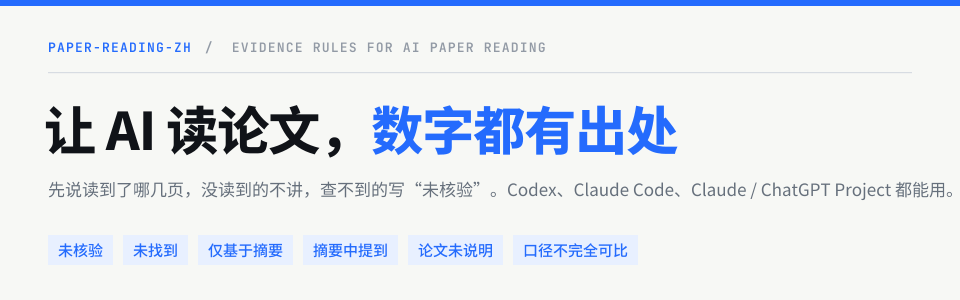
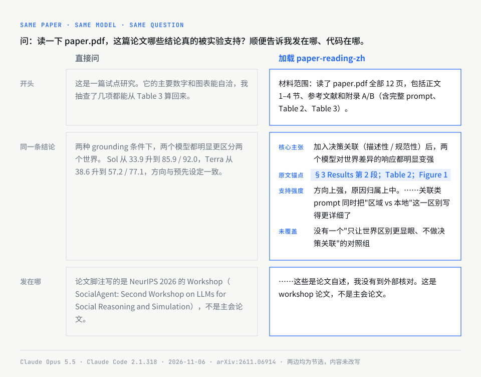

<p align="center">
  
</p>

<p align="center">
  <a href="https://github.com/MrGeDiao/paper-reading-zh/stargazers"></a>
  <a href="https://github.com/MrGeDiao/paper-reading-zh/releases"></a>
  <a href="LICENSE"></a>
</p>

paper-reading-zh 是一套中文读论文的规则（skill），给 Codex、Claude Code 用，也能贴进 Claude Project 和 ChatGPT Project。交给它 PDF、链接或摘要，它先说明自己读到了哪些材料，再按论文类型讲问题、方法、证据和局限。实验数字要标出 Table、Figure 或章节；venue 和代码链接没核验就写“未核验”；只拿到摘要就说“仅基于摘要”，不会当成读完了全文。

一行命令装好：

```bash
npx skills add MrGeDiao/paper-reading-zh
```

<p align="center">
  
</p>

<details>
<summary>这张图怎么来的</summary>

论文是 [arXiv:2611.06914](https://arxiv.org/abs/2611.06914)（2026-11-04 提交，晚于模型训练数据截止时间）。两边都是 Claude Opus 5.5，在 Claude Code 2.1.318 里只开放读文件，不能联网，问题都是「读一下 paper.pdf，这篇论文哪些结论真的被实验支持？顺便告诉我发在哪、代码在哪。」左边关掉了 skill，右边加载 v0.5.0。图里只做了节选，内容没改。

要说清楚的是：直接问的那一版质量也不错，它同样指出了“grounding 效果和信息更显眼混在一起”这个问题。差别在出处：左边整篇只零星提到 Table 3 和第 2 页；右边先声明读了多少，每条主张都对应到章节和表号，支持强度写了依据，元数据注明没有到外部核对。读完想回原文逐条核对，右边可以直接对上。

</details>

## 安装

**Claude Code、Codex 和其他支持 skills 的工具**

```bash
npx skills add MrGeDiao/paper-reading-zh
```

运行后选择要装到哪些工具。只会装上 `paper-reading-zh/` 这一个目录，共四个文本文件，没有脚本。默认只对当前项目生效，加 `--global` 后所有项目都能用。

<details>
<summary>手动复制</summary>

```bash
git clone https://github.com/MrGeDiao/paper-reading-zh.git
cd paper-reading-zh

# Codex
mkdir -p "${CODEX_HOME:-$HOME/.codex}/skills"
cp -R paper-reading-zh "${CODEX_HOME:-$HOME/.codex}/skills/"

# Claude Code
mkdir -p "$HOME/.claude/skills"
cp -R paper-reading-zh "$HOME/.claude/skills/"
```

要复制的是仓库里的 `paper-reading-zh/` 子目录，不是整个仓库。升级时先删掉旧的 `paper-reading-zh/` 再复制；直接覆盖会嵌套出 `paper-reading-zh/paper-reading-zh/`。Hermes Agent 放到 `~/.hermes/skills/`，OpenClaw 放到 `~/.agents/skills/`，需要保留完整目录。

</details>

**Claude Project / ChatGPT Project**

新建一个 Project，把 [`prompts/project-instructions.md`](./prompts/project-instructions.md) 的全文粘贴到 instructions，再上传论文。两个平台用同一份，不到 8000 字符。网页版能不能联网核验、能不能看到 PDF 里的图，取决于平台；做不到时它会先说明限制。细节见 [prompts/README.md](./prompts/README.md)。

## 怎么用

装好后不用记命令，直接在对话里给论文、提要求：

| 想要 | 可以这样说 | 输出 |
|---|---|---|
| 读懂一篇 | `精读这篇论文：https://arxiv.org/abs/…`、`看看这篇` | 材料范围、关键词、一段话总结、基本信息，再按论文类型展开，默认不超过 3500 字 |
| 快速了解 | `总结一下`、`TL;DR` | 只给材料范围和前置块，不展开正文 |
| 复现或接入 | `从工程复现角度拆一下`、`这篇能不能落地` | 模块、数据流、关键公式、论文未说明的缺口、接入判断 |
| 比较几篇 | `比较这三篇` | 先确认比较维度，再对口径：数据集、指标、规模不一致就标出来 |
| 核对结论 | `哪些结论真的被实验支持` | 主张、原文锚点、证据类型、支持强度和依据、未覆盖问题 |
| 准备组会 | `讲给组会新人听`、`按图表顺序讲` | 叙事加强，或按 Figure / Table 的出现顺序推进，可以和上面任一项叠加 |

只丢一个 PDF、什么都不说时，它会先问你想怎么读；只说“帮我看看论文”时，会先问是哪篇。

## 它守的规矩

| 遇到 | 它会 |
|---|---|
| venue、年份、CCF、代码链接 | 能联网就按 arXiv、OpenReview / ACM / IEEE、Hugging Face Papers、Semantic Scholar / DBLP 的顺序核验；没核验写“未核验”，找过没找到写“未找到”；非官方代码标“非官方实现” |
| 实验数字 | 标到 Table / Figure / 章节 / 页码，定位不到就不写；只在摘要里出现的写“摘要中提到” |
| 只拿到摘要，或认出了论文但没读到正文 | 写“仅基于摘要”，先问要不要继续做轻量解读，不靠记忆补章节、图表和数字 |
| PDF 只读到一部分 | 按实际读到的页码说明范围，不因为文件有 15 页就说读完了全文 |
| 公式乱码、图看不到 | 说明抽取异常，不重构公式，不描述看不见的曲线和坐标 |
| 多篇比较 | 数据集、评估协议、模型规模、训练预算、指标定义不一致时，标“口径不完全可比”或“口径未核验”，不直接排名 |
| 论文没写的实现细节 | 写“论文未说明”，不用合理猜测补齐 |
| 路线图、未发布产品、内部 benchmark | 标注“论文内部声明 / 作者预测 / 已公开第三方核验 / 未核验” |

批判性讨论分四层写：论文声称了什么，证据实际支持了什么，可以合理推断什么，哪些没覆盖。

## 按论文类型调整结构

系统论文没有“消融实验”，理论论文的证据是证明，benchmark 论文要看数据泄漏和许可。所以它会先判断论文靠什么建立贡献，再选主体结构：

- **标准方法 / 实验**：算法、模型、训练方法，靠实验和消融验证。
- **系统 / 测量**：架构、真实部署、trace、采样和有效性威胁。
- **数据集 / benchmark**：数据构建、标注、划分、指标、泄漏、许可和维护。
- **理论 / 证明**：假设、定理、证明依赖和适用范围。
- **综述 / 立场**：文献选择、分类框架、论证链和作者偏向。
- **观点 / 路线图**：趋势判断、产业假设和预测。

判断不了类型时，它只保留材料支持的章节，不硬套模板。各类型的骨架见 [paper-types.md](./paper-reading-zh/references/paper-types.md)。

## 平台与验证

| 平台 | 状态 |
|---|---|
| Codex、Claude Code | Primary |
| Claude Project、ChatGPT Project | Primary |
| ChatGPT Skills beta、Hermes Agent、OpenClaw | Compatible, not first-regression-tested |

Primary 指优先维护和验证的平台，Compatible 指按格式预期可用、还没做过首轮完整回归。

验证做到了哪一步：

- v0.5.0 在 Claude Code（Opus 5.5）上重跑了 5 个触发用例：只给 PDF、总结、只有摘要、没给论文、纯翻译，结果都符合预期。另外跑了一次真实 PDF 的证据审计，就是上面那张图。
- v0.4.0 在 Codex 和 Claude Code 上跑过 18 个回归用例的两轮测试，最终版 Codex 完成 11 个、Claude Code 完成 8 个，其余因额度不足没有验证。记录在 [docs/validation/](./docs/validation/)。
- 模型认出知名论文后，可能用训练记忆冒充已读全文。v0.3.0 在 Codex 上复现过，之后没再复现，不代表不会发生。
- Claude Project、ChatGPT Project 还没在真实平台上实测。

## 不做什么

不是翻译器，不是文献管理器，不默认生成 PPT、BibTeX 或全文翻译。skill 本体没有脚本和外部依赖，不会自动下载论文，也不会 clone 代码仓库；公式和代码对齐只在你提供代码时才做。非 CS 论文可以读，但不会硬给 CCF 等级或工程复现建议。

## 反馈论文被读错

如果它补出了一个查不到的 venue、描述了看不见的图，或者数字没有出处，请用 [paper_misread 模板](https://github.com/MrGeDiao/paper-reading-zh/issues/new?template=paper_misread.yml)提 issue，附上论文链接和出错的那段输出。这类案例会直接加进回归用例。

## 更多

- [CHANGELOG.md](./CHANGELOG.md)：版本变化
- [DESIGN.md](./DESIGN.md)：设计口径、平台矩阵、网页版和 Agent 版的差异
- [CONTRIBUTING.md](./CONTRIBUTING.md)：改规则时要同步哪些文件、跑什么检查

感谢 [LINUX DO](https://linux.do) 社区。

## License

MIT
